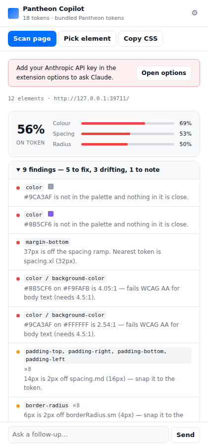
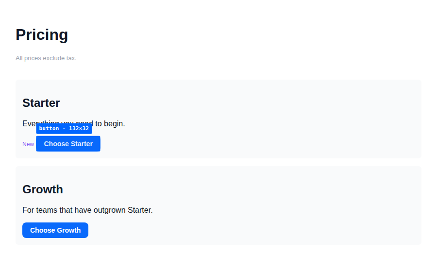
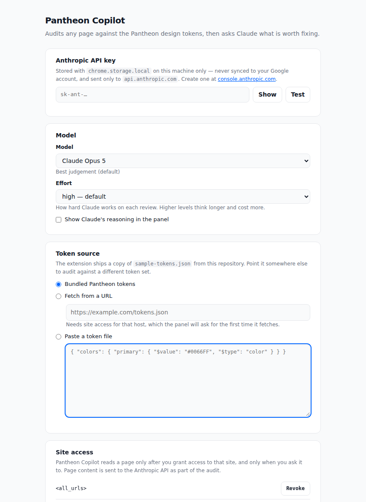

# Pantheon Copilot

A Chrome extension that audits any web page against the Pantheon design tokens
and asks Claude what is worth fixing.

It answers a question that is tedious to answer by hand: *is this page actually
built on our design system?* It reads the computed styles of every visible
element, compares each colour, spacing value and radius against
[`sample-tokens.json`](../sample-tokens.json), and reports the drift — then hands
the audit to Claude, which explains which findings matter and writes the CSS to
close them.



## Add it to Chrome

The extension is not on the Chrome Web Store; you load it from this repository.

```bash
cd extension
npm install
npm run build
```

Then, in Chrome:

1. Open `chrome://extensions`.
2. Turn on **Developer mode** (top right).
3. Click **Load unpacked** and select the **`extension/dist`** folder.
4. Pin *Pantheon Copilot* to the toolbar, and click it to open the side panel.

Requires Chrome 116 or newer (the side panel API landed in 114; 116 is the
manifest's floor). Chrome forgets unpacked extensions when it restarts with
Developer mode off, so leave that toggle on.

To add the API key: click the ⚙ in the panel, or right-click the toolbar icon →
**Options**. Paste an Anthropic API key from
[console.anthropic.com](https://console.anthropic.com/settings/keys) and press
**Test** to confirm it works. The audit runs without a key; only Claude's
commentary needs one.

`npm run package` writes `pantheon-claude-extension.zip` if you would rather
distribute the build than the source.

## What it does

**Scan page** walks every visible element, tallies the design values in use, and
scores the page against the token set.

```
56% on token   colour 69%   spacing 53%   radius 50%
```

Each finding says what the value is, which token it should have been, and how
far off it is:

| Severity | Meaning |
| --- | --- |
| **error** | Off the system. A colour with no near token, a dimension off the ramp, or a WCAG AA contrast failure. |
| **warning** | Drift. Close enough to a token to be a drifted copy of it — snap it back. |
| **info** | Worth knowing. Passes AA but not AAA, for example. |

**Pick element** lets you click one element on the page and audit just that,
which is the faster loop when you already know what looks wrong.



**Copy CSS** puts the whole token set on your clipboard as a `:root` block of
custom properties, ready to paste into a stylesheet.

Then ask follow-ups in the panel — "which of these are in our own components
rather than the third-party widget?", "write the patch for the card" — and the
conversation keeps the audit in context.

## How drift is judged

Three decisions do most of the work, and all three are tuned to avoid crying
wolf:

**Colours are compared perceptually, not as strings.** The same token reaches a
page as `#0066FF`, `rgb(0, 102, 255)` or `color(srgb 0 0.4 1)`, and antialiasing
and opacity nudge it further. Every colour is converted to CIELAB and compared
with CIEDE2000, so the bands mean something visual: under 1 ΔE is the token,
under 3 ΔE is drift from it, beyond that is off-system. Past 10 ΔE the extension
stops naming a "nearest token" at all, because two colours that far apart read as
different hues and the suggestion would mislead.

**Browser defaults are not design decisions.** Every `<h2>` carries a margin and
every `<ul>` a 40px inset from Chrome's own stylesheet. Reporting those would
bury the values the page actually chose, so each box value is compared against a
baseline measured from a bare element of the same tag — at the same font size,
since the defaults are em-based.

**Dimensions are matched within their own ramp.** A 30px gap is compared against
the spacing scale, never against a border radius that happens to sit closer.

Contrast is checked to WCAG 2.1, with large text (≥24px, or ≥18.66px bold) held
to the lower AA threshold, against the real backdrop resolved by walking up
through transparent ancestors.

## Configuration



- **API key** — stored with `chrome.storage.local` on this machine only. It is
  never put in `storage.sync`, so it does not travel to your Google account.
- **Model** — Claude Opus 5 by default; Sonnet 5 and Haiku 4.5 are offered for
  faster, cheaper reviews. **Effort** controls how hard Claude works per review
  (Haiku takes no effort level, so the control disables itself).
- **Token source** — the bundled copy of `sample-tokens.json`, a URL fetched at
  audit time, or a token file pasted straight in. Pasted JSON is validated as you
  type.
- **Site access** — lists the sites you have granted and lets you revoke any of
  them.

## Privacy

The extension reads a page only when you ask it to, and only after Chrome has
granted access to that site. What leaves your machine, and where it goes:

- **To `api.anthropic.com`, when you ask Claude:** the audit — the page title and
  URL, the style values found, the CSS selectors of example elements, and the
  text of an element you pick. Not the page's full content, and not its DOM.
- **Nowhere else.** There is no analytics, no telemetry and no backend of our
  own. The API key and settings stay in local extension storage; transcripts live
  in `chrome.storage.session` and are dropped when the tab closes.

Every network call is made from the service worker, so the key never enters a
page or the panel's DOM.

## Layout

```
extension/
  manifest.json           Manifest V3
  build.mjs               esbuild bundle → dist/ (the folder Chrome loads)
  src/
    background/
      service-worker.js   Orchestrates scans, audits and Claude turns
      claude.js           The Anthropic client — the only holder of the API key
      settings.js         Settings and the cached token index
    content/
      inspector.js        Page-side collector: element picker and page tally
    sidepanel/            The panel UI
    options/              The options page
    lib/
      color.js            Colour parsing, CIEDE2000, WCAG contrast
      tokens.js           Token flattening, indexing, nearest-match
      audit.js            Findings, severities, coverage
      prompt.js           The Claude request
      markdown.js         The panel's markdown renderer
  test/                   Unit tests, browser tests, screenshot tool
```

Two notes on the design. The service worker is the only component that holds the
API key or calls the API; the panel sends intents over a port and renders what
comes back. And because MV3 may unload the worker between turns, the conversation
is kept in `chrome.storage.session` rather than in memory, where it would
silently vanish.

The bundled tokens are copied from `../sample-tokens.json` at build time, so the
repository has one source of truth. `PANTHEON_TOKENS=/path/to/tokens.json npm run
build` bundles a different file.

## Development

```bash
npm run watch   # rebuild dist/ on change — then hit Reload in chrome://extensions
npm test        # build, then the full suite
npm run test:logic   # just the fast unit tests, no browser
```

The suite has three layers:

- **`test/logic.test.mjs`** — the colour maths, token index, audit verdicts and
  markdown renderer, in Node.
- **`test/collector.test.mjs`** — the *built* collector running in real Chromium
  against [`test/fixture.html`](test/fixture.html), a page with deliberately
  planted drift. Only `chrome.runtime` is stubbed, so the DOM walking, computed
  style reads and selector generation are the real thing; the resulting scan is
  then pushed through the real audit engine.
- **`test/extension.test.mjs`** — the extension loaded into Chromium: the
  manifest is accepted, the MV3 worker starts with the Anthropic SDK bundled into
  it, and both extension pages render and round-trip through the worker.

`node test/screenshot.mjs` regenerates the images above from a real scan.

Contributors need a Chromium for the browser tests. Playwright downloads one on
install; if your machine already has one at a fixed path, point
`PLAYWRIGHT_CHROMIUM_EXECUTABLE` or `PLAYWRIGHT_BROWSERS_PATH` at it and the
tests will use that instead.

### Not yet covered by tests

The Claude request path is exercised only up to the point of sending: there is no
test that makes a real API call, since that needs a key and spends money. The
request shape (model, streaming, adaptive thinking, the cached system prefix,
refusal fallbacks) is asserted, but the streaming and error-handling code has not
been run against the live API.
